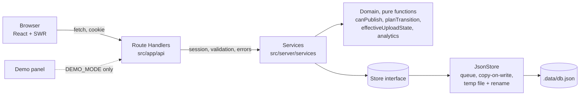
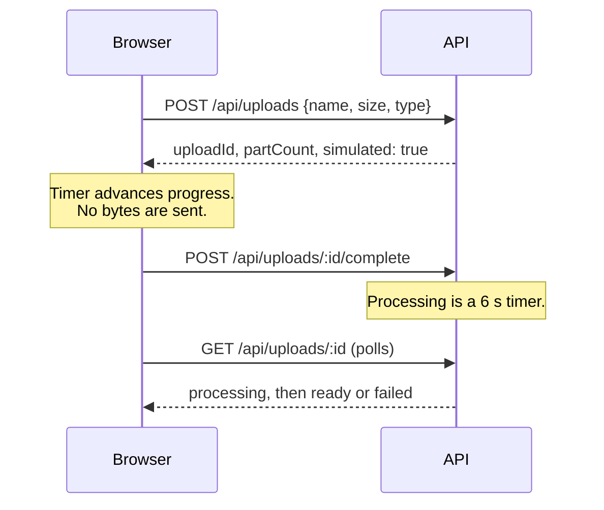
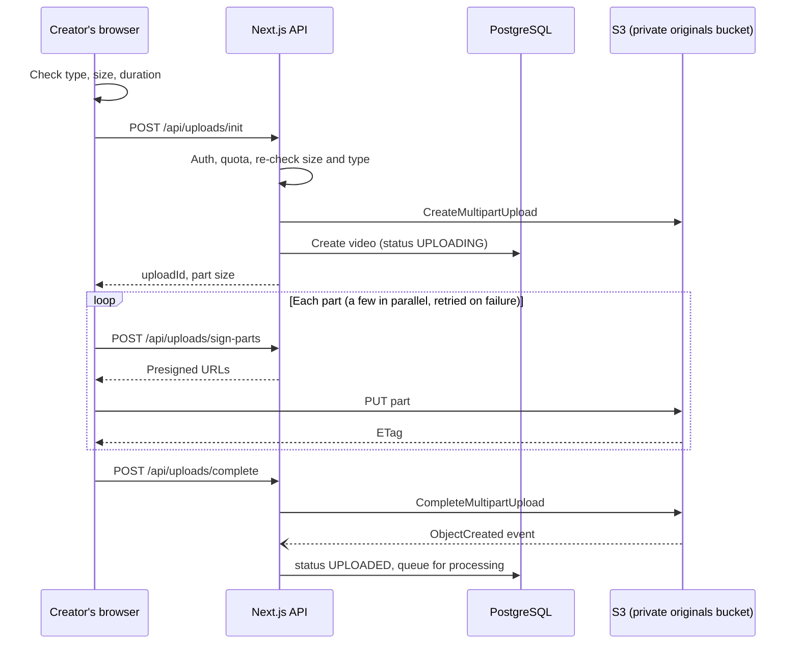
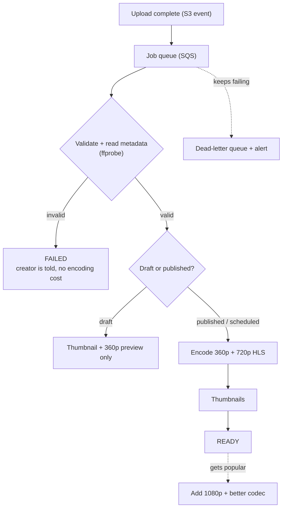
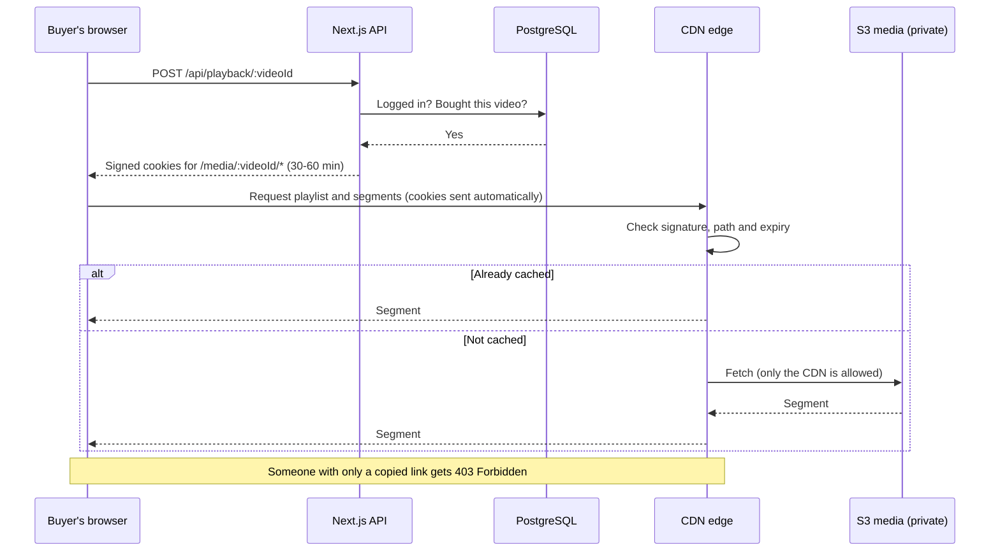
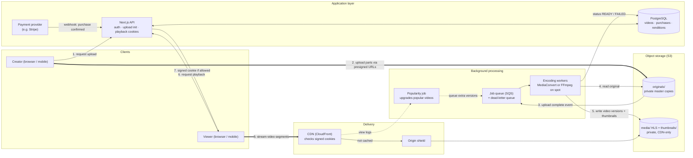

# Architecture

This document has three parts. **Part 1** describes what is actually built in this repo. **Part 2** is the production
video architecture (upload, processing, storage, delivery, paid content, scale and cost) — none of it is implemented here;
it answers Part Five of the brief. **Part 3** is a reproducible infrastructure cost model (`npm run cost-model`) with
alternate CDN scenarios; use it to re-validate prices before committing spend.

## Part 1: The demo as built



* **Browser to handler.** SWR fetches and caches; mutations call the same handlers.
* **Handlers** do only HTTP work: resolve the session to a creator, validate the body with a shared Zod schema,
  turn thrown errors into one error shape. They hold no business rules.
* **Services** hold operations (`createContent`, `publishContent`, `submitVerification`...), always filtering by the
  session's creator ID.
* **Domain** is pure: no I/O and no clock reads (time is passed in), which is why the rules are exhaustively testable.
* **Store** is the only thing that touches data. Swapping in PostgreSQL means writing another implementation of
  `read` and `write`.

**Reads never write.** `GET` handlers compute status in memory from stored data plus the clock; `runDueJobs` persists
the same computation and runs at the start of writes or on demand (the demo's stand-in for a scheduler).

### Simulated upload



The shape deliberately mirrors the production flow below (initiate, parts, complete, asynchronous processing), so
replacing the simulation changes the transport, not the model.

---

## Part 2: Video architecture (production — not implemented)

This covers Part Five of the brief (upload, processing, storage, delivery, paid content, cost), the architecture
diagram, and the scale and cost section.

None of the video infrastructure is built in this repo. This is how I'd build it for real. I've used AWS service names
to keep things concrete, but the same design works on Cloudflare, Google Cloud or Azure.

The short version:

- Video files never go through our app server. Creators upload straight to S3, and viewers stream from a CDN.
- The Next.js API only handles the small decisions: who is allowed to upload, and who is allowed to watch.
- Processing happens in the background through a queue, so a slow or failed job never affects the dashboard.
- For cost, the main idea is simple: don't spend extra money on a video until it actually has viewers.

### A. Upload

#### Should large video files go through the main server?

No. A 3 GB upload on a slow connection can take 20 minutes or more, and our server would be stuck holding that connection
the whole time. A few dozen creators uploading at once would slow down the API for everyone else. It also costs more,
because every byte travels twice (creator to server, then server to storage). And it wouldn't work on serverless hosting
like Vercel at all, where request bodies are limited to a few MB.

So the server's job is to say "yes, you can upload this", and the file goes directly to S3.

#### How it works

When a creator picks a file, the frontend asks our API for permission. The API checks they're logged in, checks the file
size and type, creates a video record, and starts a multipart upload in S3.

The browser splits the file into parts and asks the API for presigned URLs. These are temporary links that allow
uploading one part to one exact location in S3, and they expire quickly. The browser uploads the parts straight to S3,
then tells the API it's done, and the API asks S3 to join them into one file.



Small files (under about 100 MB) just use a single presigned PUT. Multipart is for the big ones. S3 doesn't allow a
single PUT over 5 GB, and a single request can't resume if it fails halfway.

#### Slow connections and interrupted uploads

Splitting the file is what makes uploads resumable. If a 3 GB file goes up in 10 MB parts and the connection drops at
90%, the first 270 parts are already safe in S3. When the connection returns, the browser checks which parts S3 has and
uploads only the rest. This works even after a page refresh, because the upload ID is saved in the database and the
browser.

A failed part is retried on its own, with a growing wait between attempts. The browser also pauses automatically when it
goes offline and continues when it's back. For creators far from our storage region, S3 Transfer Acceleration can route
uploads through the nearest AWS edge location.

#### Progress and mobile

`fetch` doesn't report upload progress, so each part is sent with `XMLHttpRequest`. I add up all the parts to show one
percentage, plus speed and time remaining, with pause, resume and cancel.

Phones get smaller parts (5 to 10 MB) and only one or two uploads at a time, since mobile connections drop more often.
Desktop gets bigger parts and three or four in parallel. Closing the tab mid-upload shows a warning, and the Wake Lock
API keeps the screen awake where supported. Since progress is saved per part, switching apps or losing signal doesn't
mean starting over.

#### File validation

I validate in three places. The browser checks type, size and duration for instant feedback, but anyone can bypass that,
so it's only for convenience. The server checks again before handing out any URLs, enforces limits per creator, and picks
the storage path itself (`originals/{creatorId}/{videoId}/source`). The original filename is never used as a path. After
upload, the processing step checks the actual file contents, which is the check that really matters (section B).

#### Easy-to-miss details

- The bucket's CORS settings must expose the `ETag` header, or the browser can't read part IDs and the final step fails.
- Abandoned multipart uploads don't appear in the S3 console but still cost money. A lifecycle rule deletes them after 7 days.
- An upload only counts as finished when S3's event says so, not when the browser says so.

If I had to ship quickly, I'd use Mux or Cloudflare Stream, which do resumable uploads out of the box. The S3 approach
gives us more control over cost later.

### B. Processing

When S3 confirms the upload, it puts a job on a queue (SQS). Workers pick up jobs and process videos in the background.
If a worker crashes, the job goes back on the queue and gets retried.



**Validate and read metadata.** `ffprobe` reads the file header in a few seconds and gives us the real format, codecs,
duration, resolution, frame rate and whether there's audio. Renamed files, corrupt uploads and videos over the length
limit stop here. This step costs seconds, while finding the same problem 20 minutes into encoding wastes real money.

**Transcode.** Creators upload all kinds of formats, like iPhone HEVC `.mov` files. We convert everything to H.264 video
with AAC audio, which plays on basically every device, and compress it to normal streaming bitrates. We also make a few
versions at different resolutions:

| Version | Bitrate (approx.) | When |
|---|---|---|
| 360p | 0.8 Mbps | Always |
| 720p | 2.5 Mbps | Always, if the source is 720p or higher |
| 1080p | 5 Mbps | Only once the video gets popular, and only if the source is 1080p+ |

We never upscale. A 1080p version of a 720p source is just a bigger file that doesn't look any better.

**Package for streaming.** Each version is cut into 4 to 6 second HLS segments, with playlists listing them. Every segment
starts with a keyframe, so the player can switch quality or jump anywhere cleanly. This is how different devices and
network speeds are handled: if the connection gets worse, the next segment comes from 360p instead of 720p, and the video
keeps playing instead of freezing. HLS plays natively on Safari and iOS, and through `hls.js` everywhere else.

**Thumbnails.** If the creator uploaded one, we use it. Otherwise we grab a few frames from the video as small WebP
images and let the creator pick.

#### Status and failures

Processing status (`UPLOADING`, `PROCESSING`, `READY`, `FAILED`) is separate from publishing status (Draft, Scheduled,
Published). Publishing needs a verified creator and a `READY` video. Jobs that keep failing go to a dead-letter queue,
an alert fires, and the creator sees a clear error with a retry button instead of a video stuck on "processing". Outputs
are saved per video and resolution, so a retried job skips anything already done.

#### Keeping processing costs down

Encoding is the expensive part, so the savings come from doing less of it. We validate first, so we never pay to encode
broken files, and we never upscale. Every video starts with only 360p and 720p, since most videos get very few views.
1080p comes later, once a video proves it's popular. Drafts only get a thumbnail and a low-quality preview, and the full
encode runs when the creator publishes (scheduled videos get processed ahead of time). A lot of drafts never get
published, so this adds up.

For the first version I'd use AWS MediaConvert, which charges per minute and needs no servers. At higher volume, our own
FFmpeg workers on spot instances become much cheaper, and since jobs can be retried safely, losing a spot instance doesn't
matter. Switching later is easy because the workers sit behind the same queue.

### C. Storage

Video files and metadata are very different, so they live in different places.

Videos and thumbnails go in **object storage (S3)**. They're big, written once and read many times. S3 is cheap per GB,
extremely durable, has no real size limit, and plugs straight into a CDN.

Metadata goes in **PostgreSQL**: title, description, price, statuses, duration, resolution, which versions exist, file
paths, and view and purchase counts. It's small, structured data with relationships between creators, videos and
purchases, and we query it constantly. Video bytes never go in the database.

**Originals** go in a private bucket that only the workers can read. I'd keep them forever, because if we later want a
new resolution or a better codec, we can re-encode without asking creators to upload again. After 30 days they move to S3
Glacier Instant Retrieval, which is about 80% cheaper and still readable instantly.

**Processed videos** go in a private bucket that only the CDN can read. That matters for paid content, because there's no
direct link anyone could share (section E).

**Thumbnails** are served through the CDN with long caching. A changed thumbnail gets a new file name, so nobody sees an
old cached one.

```
originals/{creatorId}/{videoId}/source.mp4
media/{videoId}/hls/master.m3u8
media/{videoId}/hls/720p/segment_00001.m4s
thumbnails/{videoId}/poster.webp
```

The database stores these paths, not full URLs, so changing CDN or storage provider later doesn't mean updating millions
of rows.

To keep storage costs down, processed videos use S3 Intelligent-Tiering, which moves rarely watched files to cheaper
storage on its own. For videos nobody has watched in a long time, we can delete the processed versions and rebuild them
from the original if needed. Cloudflare R2 is also worth considering instead of S3, since it doesn't charge for data
leaving storage.

### D. Streaming and Content Delivery

Viewers never download from S3 directly. Everything goes through a CDN (CloudFront), which has servers all over the world.
A viewer in Brazil gets segments from São Paulo instead of our storage region. The first request in a region fetches the
segment and keeps a copy, and everyone after that gets it locally. Between the CDN and S3 I'd add an origin shield, an
extra cache layer so that if 50 CDN locations ask for the same new segment, S3 only serves it once.

**Caching.** Segments never change once created, so they're cached for up to a year. Finished playlists and thumbnails
are cached for a long time too. The only thing not cached is the API call that checks whether someone can watch. One thing
that's easy to get wrong: per-user tokens must not end up in the cache key. Otherwise every request looks unique, nothing
is shared from cache, and every view hits S3. Signed cookies (section E) avoid this.

**Startup and seeking.** The thumbnail shows immediately, and the playlist loads as soon as the page opens, before the
user presses play. Playback starts at lower quality so the first segment arrives fast, then goes up. Seeking to minute 37
only downloads the segment for minute 37, because every segment can be played on its own.

**Adaptive quality and bandwidth.** The player picks quality based on connection speed and buffer, and can switch at every
segment. To save bandwidth, I'd cap quality at the player's size, because sending 1080p to a small phone screen wastes
data and looks the same. I also wouldn't preload whole videos, only the playlist and first segment.

**Popular vs rarely watched.** Popular videos stay in the CDN cache because they're requested constantly, so they almost
never touch S3. Rarely watched videos mostly miss the cache and come from S3 through the origin shield. They start a bit
slower, which is fine for something watched a handful of times. I wouldn't push videos to CDN locations in advance, except
maybe for a big creator's launch.

**Different countries.** The CDN routes viewers to the nearest location automatically. If one region becomes a big share
of the audience, I'd copy popular videos to storage there.

### E. Paid Content Protection

If a paid video lived at a permanent URL, one buyer could post the link and everyone could watch for free. I'd prevent
that in three layers:

1. **Private storage.** The S3 media bucket rejects every direct request. Only the CDN can read it, so there's no permanent link to the files.
2. **Signed access at the CDN.** The CDN only serves video to requests with a valid signature, tied to one video and expiring after a set time.
3. **Only our API signs.** It does so only after checking the user is logged in and has bought the video.



**Why cookies, not signed URLs.** One HLS video is hundreds of segment files. Signing each URL separately is messy and
breaks caching, since every user gets different URLs. A CloudFront signed cookie covers a whole folder like `/media/123/*`,
the browser sends it automatically, and URLs stay the same for everyone. The CDN just needs to be on a subdomain of our
app (like `media.creatorhub.com`). It checks the signature with a public key, without calling our API, so there's almost
no added delay.

**Expiry and refunds.** Cookies last 30 to 60 minutes. For longer videos, the player asks for new ones before they
expire, and the API checks the purchase again each time. So a refund or a banned account loses access within the hour,
with no separate system needed.

**Why sharing fails.** A copied URL doesn't work without the cookie, and the cookie only covers one video and expires
soon. I'd also limit how many streams one account can watch at once, which catches most account sharing.

**When payment succeeds but access doesn't.** Purchases come from the payment provider's webhook, processed once per
payment ID so retries don't create duplicates. If the webhook is late, the playback endpoint can check with the provider
directly, and a background job regularly fixes any payment without a matching purchase. Any mismatch should alert someone,
because it means a customer paid and can't watch.

**What this doesn't stop.** Screen recording, or downloading segments while access is valid. If we ever need more
protection for high-value content, the next steps are DRM (Widevine and FairPlay) and invisible per-user watermarks to
trace leaks.

### F. Cost Efficiency

The thing that made the cost side click for me is that video costs come in two types. Encoding is paid once per video, no
matter how many people watch. Bandwidth is paid every time someone watches. For a video with 5 views, bandwidth is almost
nothing. For a video with 500,000 views, bandwidth is the whole bill.

#### Should a 5-view video be treated the same as a 500,000-view video?

No. Take a 10-minute video at 720p (about 2.5 Mbps). One full view is about 190 MB. Five views is about 1 GB of bandwidth,
a few cents. 500,000 views is about 94 TB, roughly $2,000 to $8,000 depending on volume pricing and where viewers are.

Re-encoding with a more efficient codec like AV1 or HEVC makes files around 30% smaller and costs a few dollars. On the
popular video, that saves around $600 to $2,400. On the 5-view video it saves less than a cent, so we'd lose money.

So videos move up in treatment based on real views:

- **Most videos (few views):** 360p and 720p only, served from S3 through the origin shield, moved to cheaper storage when they go quiet.
- **Videos past a view threshold:** add 1080p and seek previews.
- **Very popular videos:** add the efficient codecs and warm the CDN cache for big launches.

I'd only build the first two levels at the start. The third adds complexity and is only worth it once real traffic data
shows the savings.

#### Where else money is saved

Most of this is covered in the sections above, but in one place:

- **Encoding:** validate first, no upscaling, two resolutions to start, minimal work for drafts.
- **Compute:** workers scale with the queue (down to zero when idle) and run on spot instances. The API stays small because video never passes through it.
- **Storage:** old originals and quiet videos move to cheaper tiers, unused processed versions can be rebuilt instead of kept, and abandoned uploads are cleaned up.
- **Bandwidth:** high cache hit rate, quality capped to screen size, no full preloading, better codecs for popular videos.
- **Repeated requests:** the CDN serves cached segments, one cookie covers a whole viewing session, and view counts are added up in batches instead of a database write per view.

### Architecture diagram



The thick arrows are where video data actually moves: creators uploading and viewers streaming. Neither goes through the
API. The dotted arrows are the cost loop from section F, where view data decides which videos get upgraded.

Nothing here depends on AWS. Cloudflare (R2, Stream, Workers) or Google Cloud would work the same way, and since
bandwidth ends up being the biggest cost, a provider without egress fees like Cloudflare R2 would be worth a serious look
as we grow.

### Failure paths

| What fails | What the system does | What the creator sees |
|---|---|---|
| Connection drops mid-upload | Acknowledged parts are kept; client resumes from the next part | "Connection lost. N of M parts are safely uploaded"; Resume |
| Browser closed, file gone | Upload stays `initiated` until the lifecycle abort | "Select the file again to finish" (never a false "resumed") |
| Complete call fails | All parts exist; completion is idempotent, so retry | Try again |
| Validation rejects the file | Status `FAILED` with a reason; nothing is transcoded | The reason, and Upload again |
| Transcode job fails | Retry with backoff; after the limit, dead-letter and alarm; status `FAILED` | "Processing failed"; publishing blocked; any publish intent dropped with the reason |
| Duplicate completion event | Idempotency key makes the second a no-op | Nothing |
| Worker crashes mid-job | The job is visible-again on the queue and re-run | A longer wait, then ready |
| Scheduled publish no longer valid | Re-check at execution; item returns to draft | The reason on the item |
| Playback entitlement expires | Cookie lapses; the player asks for a fresh one | A brief re-authorization, or a purchase prompt |
| CDN or origin outage | Player retries, then fails over to a second CDN host or a signed origin URL; origin shield limits blast radius | A brief buffer, a lower quality, or "Having trouble playing. Retry" |
| API unavailable | Uploads keep going straight to storage; "complete" is queued and retried; playback continues until its short credential expires; reads show cached data | Stale but usable pages, a clear error with Retry, and no lost upload progress |
| **Payment succeeds but video authorization fails** | The entitlement is created idempotently from the payment ID (ideally in the same transaction, or through an outbox), so a retry can never double-grant or double-charge; a reconciliation job compares paid purchases with entitlements and repairs gaps | "Payment received. We're unlocking your video" with automatic retry and a support link; if it cannot be fixed within a short window, an automatic refund |

### Scale and cost (narrative estimate)

The scenario: 100,000 creators, 1 million videos, 10 million views a month, viewers in many countries.

#### What scales easily

Most of the heavy parts were picked because they scale on their own. S3 doesn't care how many videos it holds. Uploads go
straight to S3, so more creators don't load our servers. The CDN gets more efficient with more viewers, because popular
videos stay cached. The queue scales by adding workers, and the API is stateless, so we can run more copies. Since the
CDN checks cookies itself, streaming doesn't touch our API after the first request.

#### Likely bottlenecks

The database is the first thing I'd expect to struggle. It handles permission checks for every playback, view counts, and
dashboard queries that add up revenue across large tables.

Encoding can back up during upload spikes, and creators then wait longer for videos to be ready.

With a million videos, many are rarely watched and won't be cached, so lots of requests go back to S3. The origin shield
helps, but those videos start slower.

Big launches are the other risk. When a large creator publishes, thousands of people arrive in the same minute, which
means a burst of permission requests and cache misses at the same time.

#### What gets expensive

Bandwidth, by far. Then encoding, then storage. Storage only ever grows, because new videos keep piling up even if views
stay flat. Logging is the one people forget: ten million views produce a lot of logs.

#### What I'd monitor

- **Uploads:** success rate, abandon rate and upload time, split by device. If mobile fails much more than desktop, that's a product problem.
- **Processing:** jobs waiting and the age of the oldest one (the main backlog alert), time from upload to ready, failure reasons.
- **Playback:** time until the video starts, buffering, playback failures and average quality, by country. This is what viewers actually feel.
- **CDN:** cache hit rate, requests going back to S3, and error rates. A jump in 403s means an expiry bug or someone trying to get around payment.
- **API and database:** response times, errors, CPU and slow queries.
- **Money:** payments that didn't turn into access (this should page someone), and cost per view and per uploaded minute. Total spend grows anyway as the platform grows, but unit costs show whether we're getting more or less efficient.

#### What I'd change as traffic grows

I'd make these changes when monitoring shows a real problem, not all upfront. For the database: connection pooling and
read replicas first, then caching permission checks in Redis, then moving analytics to a separate system like ClickHouse
so dashboards stop hitting the main database. For encoding: switch to our own FFmpeg workers on spot instances, add priority
queues so new uploads go first, and then build the "very popular" level from section F. For the CDN: negotiate committed
pricing and consider a cheaper or second CDN. I'd only split the backend into separate services once the team is big enough
to get in each other's way.

#### Cost estimate

The numbers depend mostly on these assumptions:

- Average video: 10 minutes, with an original file of about 1 GB
- 50,000 new uploads a month (500,000 minutes), assuming the library was built over about two years
- About 250 MB per video for 360p plus 720p, and 5% of videos upgraded to 1080p
- Average watch time of 5 minutes at about 2 Mbps, so about 75 MB per view
- 10 million views × 75 MB = about 750 TB of bandwidth a month

Prices are rough AWS list prices as of October 2026 and should be double-checked in the [AWS Pricing Calculator](https://calculator.aws/).

**Storage: about $9,000 to $10,000.** Originals add up to about 1 PB. In normal S3 that's over $20,000 a month, but moving
originals older than 30 days to Glacier Instant Retrieval (around $0.004 per GB) brings it to about $5,000. Processed videos
are about 270 TB, around $4,000 with Intelligent-Tiering.

**Encoding: about $10,000 to $13,000 with MediaConvert.** It starts at about $0.0075 per output minute, and 720p counts
double, so 360p plus 720p is about $0.023 per minute of video. At 500,000 minutes, that's about $11,500. Our own FFmpeg
workers on spot instances would probably be $3,000 to $5,000, but that's my least certain number. Encoding the existing
library is a one-time cost, so it's not included.

**Bandwidth: about $35,000 to $45,000.** CloudFront gets cheaper per GB as volume grows. At North America and Europe prices,
750 TB costs:

| Volume | Price per GB | Cost |
|---|---|---|
| First 10 TB | $0.085 | ~$850 |
| Next 40 TB | $0.080 | ~$3,200 |
| Next 100 TB | $0.060 | ~$6,000 |
| Next 350 TB | $0.040 | ~$14,000 |
| Last 250 TB | $0.030 | ~$7,500 |
| **Total** | | **~$31,500** |

Viewers in Asia, India, South America and the Middle East cost more per GB, so with a global audience I'd expect $35,000
to $45,000. Request fees add about $550, and data from S3 to CloudFront is free.

**Everything else: about $3,000 to $6,000.** This covers the API (cheap, since it only handles small requests), Postgres
with a replica, the queue, analytics, and monitoring and logs. Payment fees are left out, since they scale with revenue.

| | Per month | Share |
|---|---|---|
| Bandwidth | $35k – $45k | ~60% |
| Encoding | $10k – $13k | ~17% |
| Storage | $9k – $10k | ~15% |
| Everything else | $3k – $6k | ~8% |
| **Total** | **roughly $55k – $75k** | |

That's around $0.006 per view, which is the number I'd keep an eye on.

Watch time matters most here. If people watched the full 10 minutes instead of 5, bandwidth would roughly double and the
total would get close to $100,000.

#### Biggest cost long term

Bandwidth. It grows directly with views, which is exactly what we want to grow. Encoding grows with uploads, so it becomes
a smaller share over time. Storage keeps creeping up, which is why lifecycle rules should be there from day one. The best
ways to control bandwidth are a high cache hit rate, not sending more quality than the screen needs, better codecs for
popular videos, negotiated CDN pricing, and at this scale, seriously considering providers without egress fees.

### Observability

Request IDs through every hop; structured logs. Metrics for upload start to complete rate, time to `READY` (p50/p95), queue
depth and age of the oldest message, dead-letter depth, transcode failure rate by cause, CDN cache hit ratio, edge 4xx/5xx,
rebuffer ratio and start-up time, and **cost per view**. Alarm on dead-letter messages, processing failure rate and a
rising time to ready.

### Cost controls

Tier processing by popularity; archive originals; set budgets and anomaly alerts; cap per-creator storage and concurrent
uploads; cache aggressively; review the egress mix by region every month.

---

## Part 3: Infrastructure cost estimate (cost-model)

> **This is a planning estimate, not a quote.** It comes from `npm run cost-model` (`scripts/cost-model.ts`), where
> every assumption is a named constant you can change. Prices were looked up in October 2026 and **must be
> re-validated** on each provider's own pricing page or calculator before anyone commits money.
>
> Part 2 above uses a different assumption set (75 MB per view, 50k uploads/month, two-rung ladder first). This section
> models the brief's illustrative **60 MB per view** and compares pay-as-you-go AWS against tiered storage and alternate CDN pricing.

### Assumptions

| Assumption | Value | Basis |
|---|---|---|
| Creators / stored videos / views per month | 100,000 / 1,000,000 / 10,000,000 | The brief |
| New uploads per month | 40,000 | Assumed (about 4% monthly library growth) |
| Average video | 10 minutes, 500 MB original | Assumed. The demo's seed uses longer videos, so this is conservative |
| Delivered per view | **60 MB** (600 TB a month) | The brief's illustrative figure: about 2 minutes at about 4 Mbit/s. A sensitivity table follows |
| Adaptive ladder (H.264) | 1080p 4.0, 720p 2.2, 480p 1.1, 360p 0.6 Mbit/s = 593 MB per video | Assumed |
| Viewer geography | 55% NA/EU, 12% India, 10% other Asia, 8% South America, 5% AU/NZ, 10% Middle East/Africa | Assumed, loosely shaped like the demo's purchase mix |
| Requests per view | 45 HTTPS (6-second segments over about 4 minutes, plus manifests) | Assumed |
| Platform and operations | $8,000 a month | **Placeholder, not validated** (API compute, managed database, queue, observability) |
| Retention | Library kept indefinitely; no deletion modelled | Assumed |
| Caching | Delivery is billed on bytes sent to viewers, so cache hit ratio does not change the CDN bill. It matters for origin egress when the origin is outside the CDN's provider | Pricing model |

### Prices used (looked up October 2026)

* **S3 Standard** $0.023 / $0.022 / $0.021 per GB-month (first 50 TB / next 450 / beyond). **Glacier Instant Retrieval**
  $0.004 per GB-month plus $0.03 per GB retrieved. Several aggregators agree; confirm on aws.amazon.com/s3/pricing.
* **CloudFront pay-as-you-go**, per region and tiered (10 TB, next 40, next 100, next 350, then the rest). NA/EU
  $0.085 / 0.080 / 0.060 / 0.040 / 0.020 per GB; India $0.109 first tier; Middle East and Africa $0.110; Australia/NZ
  $0.114; South America $0.170; other Asia starts at $0.120 (**later tiers for other Asia are interpolated**). HTTPS
  requests about $0.01 per 10,000. The 1 TB monthly free allowance is ignored. These come from third-party summaries of
  AWS's page, which differ slightly on the lowest tiers; AWS also introduced flat-rate plans in late 2025, which do not
  fit this volume.
* **MediaConvert, Basic tier, H.264** about $0.0075 per output minute for SD, **HD taken as twice that** (inferred from
  the published multiplier). Its volume discounts are **not applied**, so transcoding is overstated, not understated.
* **Bunny CDN Volume network** $0.005 per GB flat worldwide for the first 500 TB, from 10 locations; **Standard network**
  $0.01 EU/NA, $0.03 Asia/Oceania, $0.045 South America, $0.06 Middle East/Africa. **Bunny Storage** about $0.01 per
  GB-month, with no charge to deliver it through Bunny's CDN. Taken from Bunny's own documentation.
* **S3 internet egress** about $0.09 per GB, charged once when renditions are copied from S3 to CDN-side storage.

### The two scenarios

**A: Conventional pay-as-you-go (AWS).** Everything in S3 Standard, every upload transcoded to the full four-rung ladder,
delivery through CloudFront at list price.

**B: Cost-optimized.** Same upload and transcoding on AWS, but:

* originals move to S3 Glacier Instant Retrieval;
* **processed renditions are tiered by popularity**: the top 5% of videos keep the full ladder, the next 25% keep three rungs, the long tail (70%) keeps
  two (720p and 360p);
* new uploads are transcoded to the two-rung ladder first, and extra rungs are added only when a video earns them;
* renditions live in CDN-side storage and are delivered from Bunny's **Volume** network.

**B+** is B with the latency-sensitive regions (everywhere but NA/EU) moved to Bunny's regional **Standard** network,
because the Volume network has only ten locations.

| Monthly line item | A: pay-as-you-go AWS | B: cost-optimized | B+: B with regional Standard CDN |
|---|---|---|---|
| Storage | $23,493 | $4,798 | $4,798 |
| Transcoding | $18,000 | $10,200 | $10,200 |
| Hand-off to CDN storage (S3 egress) | $0 | $899 | $899 |
| Delivery (CDN transfer) | $48,634 | $3,000 | $12,270 |
| CDN requests | $450 | $0 | $0 |
| Platform and ops (placeholder) | $8,000 | $8,000 | $8,000 |
| **Total** | **$98,577** | **$26,897** | **$36,167** |

B is about 3.7x cheaper than A; B+ about 2.7x. Annualized, that is roughly $1.2 million against $0.32 to $0.43 million.

Reading it honestly:

* **The brief's "about $45,000 a month" matches the delivery line alone** ($48,634 for 600 TB here), not the whole
  platform. Storage and transcoding add about as much again at these volumes, so a full estimate is closer to twice that.
* **Delivery dominates scenario A and shrinks to a small line in B.** The gap comes from the CDN's per-GB price and from
  not paying twice (CloudFront's $0.085 against Bunny's $0.005 at list price).
* **Sensitivity to bytes per view is large**, because delivery is linear in it:

| MB per view | Delivered TB | A | B | B+ |
|---|---|---|---|---|
| 30 | 300 | $76,734 | $25,397 | $30,032 |
| 60 (base) | 600 | $98,577 | $26,897 | $36,167 |
| 150 | 1,500 | $152,473 | $31,397 | $54,572 |
| 300 | 3,000 | $225,073 | $38,897 | $85,247 |

  Above about 500 TB a month Bunny's Volume rate falls further (to $0.004), and above 2 PB it is negotiated, so B is
  slightly overstated in the bottom rows. B+ grows fastest because the regional Standard network costs several times
  the Volume rate. At 300 MB a view the "latency-friendly" option is more than twice the Volume-only one, which is why
  the regional split is a decision to make with real viewer-latency data rather than assume.
* **What B gives up.** Fewer edge locations in the Volume network (hence B+), a second vendor to operate, and less
  native integration for signed access than CloudFront has (check that the chosen CDN's token authentication works for
  HLS paths before committing). Negotiated or committed-use pricing, which can cut scenario A substantially, is real but
  not modelled because I could not validate a figure.
* **Not included:** payment processing, DRM or licensing, support plans, taxes, people, data transfer between AWS
  services other than the one hand-off shown, backups, and the one-time cost of transcoding the existing library.

### Why a video with five views should not get the same treatment as one with 500,000

Under the base assumptions a full ladder is 593 MB and a long-tail ladder is 210 MB, **65% less to store**, and
transcoding the full ladder costs about $45 per 100 videos against $22 for the two-rung start. Keeping one extra
rendition hot costs fractions of a cent per month, but multiplied across the roughly 700,000 videos in the long tail those
fractions become a large share of the storage and transcoding bill. If a long-tail video becomes popular, it can be
promoted (extra rungs transcoded from the archived original) at a one-off cost of about 22 cents for the two extra rungs. Paying for the full
treatment up front is paying for a prediction the system does not need to make.

### How to re-validate before relying on this

Re-run `npm run cost-model` after editing the constants, check each price against the provider's own calculator
(AWS Pricing Calculator; Bunny's pricing page), and replace the placeholder platform line with a quote or measured spend.
